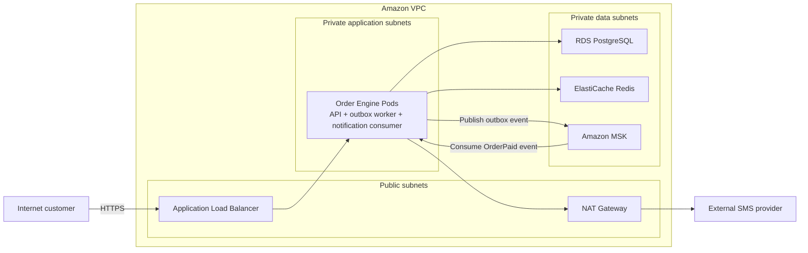

# Proposed AWS Deployment Architecture

## Purpose

This document explains how the local Order Engine could run on AWS.
It is an architecture proposal for learning and planning; these paid AWS
resources are not currently deployed.

## Main request flow

1. A customer sends an HTTPS request.
2. The Application Load Balancer receives it in the public network.
3. The load balancer forwards it to a healthy Order Engine Pod in EKS.
4. The application reads or writes order data in RDS PostgreSQL.
5. Redis provides cached order reads.
6. The outbox worker publishes paid-order events to Amazon MSK.
7. The notification consumer reads the event and calls the external SMS
   provider through the NAT Gateway.

## Architecture diagram

## Main AWS services

- ALB: public HTTPS entrance and traffic distribution.
- EKS: runs and manages the Order Engine Pods.
- EC2 managed node group: provides computers on which the Pods run.
- RDS PostgreSQL: durable source of truth for orders and outbox events.
- ElastiCache: managed Redis cache for frequently read orders.
- MSK: managed Kafka event stream for paid-order events.
- IAM: controls which AWS resources each workload may access.
- Secrets Manager: stores passwords, signing secrets, and provider keys.
- CloudWatch: collects metrics and logs and raises alarms.
- S3: stores reports, receipts, exports, and archived files.

## Availability decisions

- Run the EKS worker nodes across at least two Availability Zones.
- Keep at least two ready Order Engine Pods and spread them across nodes and
  Availability Zones.
- Use the ALB health checks and Kubernetes readiness probes so traffic reaches
  only ready Pods.
- Use RDS Multi-AZ for database failover and backups for data recovery.
- Distribute MSK brokers and replicated topic partitions across Availability
  Zones.
- Use an ElastiCache replica and automatic failover when the business requires
  the cache to remain available during a node failure.

These copies improve availability but increase cost. A single Region with
multiple Availability Zones is the starting design; a more expensive
multi-Region design is not justified by the current project requirements.

## Scaling decisions

- Use the Kubernetes Horizontal Pod Autoscaler to add or remove Order Engine
  Pods when measured CPU load changes.
- Keep a minimum of two Pods for availability and apply a tested maximum so
  application scaling cannot overwhelm PostgreSQL, Redis, Kafka, or the SMS
  provider.
- Use an EKS managed EC2 node group and a cluster autoscaler so pending Pods
  can trigger additional node capacity when the existing nodes are full.
- Scale RDS, ElastiCache, and MSK independently from the application. More
  application Pods do not automatically create more database connections,
  cache capacity, Kafka partitions, or provider capacity safely.
- Monitor JVM memory, but do not use memory-based autoscaling until load tests
  establish a useful target. A JVM may keep memory for reuse after requests
  finish, so high allocated memory does not always mean more Pods are needed.

The local HPA target of 60% CPU with two to five Pods is learning evidence,
not a production capacity recommendation. Production values must come from
load tests, service limits, and measured dependency capacity.

## Security decisions

- Expose only the Application Load Balancer to the public internet.
- Keep EKS workloads, RDS, ElastiCache, and MSK in private subnets.
- Use security groups to allow only the required connections between
  components.
- Use HTTPS for traffic entering through the ALB and encryption for stored
  data and internal service traffic where supported.
- Give EKS workloads IAM roles with temporary credentials and least-privilege
  permissions.
- Store database passwords, JWT signing secrets, and provider API keys in
  Secrets Manager instead of source control or container images.
- Continue using Spring Security JWT roles to control access inside the Order
  Engine API.

Application JWT roles control what a user may do inside the API. IAM roles
control what an application workload may do with AWS resources.

## Cost decisions

- Start in one Region across multiple Availability Zones rather than paying
  for a multi-Region deployment without a business recovery requirement.
- Keep the minimum application replica count needed for availability, then
  let autoscaling respond within tested limits.
- Add an RDS read replica only after measurements show that read traffic is a
  database bottleneck.
- Add Redis replicas or shards only when availability or measured cache load
  requires them.
- Choose MSK when retained event streams, consumer offsets, replay, ordering,
  or high throughput justify it. For a simple background job, SQS, or SNS plus
  SQS for fan-out, would be less complex and may cost less to operate.
- Set CloudWatch log-retention periods and alarms deliberately so unused logs
  and noisy custom metrics do not create unnecessary cost.
- Review NAT Gateway and cross-Availability-Zone data-transfer costs because
  network architecture also contributes to the bill.

The goal is not the cheapest possible system. It is the least expensive
design that still meets the required reliability, security, recovery, and
performance targets.

## Failure behavior and limits

- A failed Pod is replaced by Kubernetes, and the ALB sends traffic only to
  ready Pods.
- A failed node can be replaced by the managed node group; Pods can be placed
  on another node with available capacity.
- A single Availability Zone failure is handled by spreading capacity across
  zones and using Multi-AZ managed services.
- A Redis failure may make reads slower, but PostgreSQL remains the source of
  truth and the application should continue with a cache miss when possible.
- A Kafka publishing failure leaves the durable outbox event in PostgreSQL for
  retry. A permanently failing consumer message reaches the DLT for human
  investigation.
- An unavailable SMS provider does not reverse a committed `PAID` order.
  Timeouts, circuit breaking, retries, idempotency, and the DLT limit the
  effect of that external failure.
- A complete Region failure is outside this starting design. Multi-Region
  recovery would require an explicit data-replication, traffic-failover,
  consistency, testing, and cost plan.

Managed AWS services reduce infrastructure work, but they do not choose the
application's schema, indexes, retention, idempotency behavior, retry policy,
or incident-response process. Those remain engineering responsibilities.

## Local-to-AWS mapping

| Local learning component | Proposed AWS component |
| --- | --- |
| Docker Desktop Kubernetes | Amazon EKS |
| Local Kubernetes node | EC2 managed node group |
| Kubernetes Service/port-forward | Application Load Balancer and Kubernetes Service |
| Compose PostgreSQL | Amazon RDS for PostgreSQL |
| Compose Redis | Amazon ElastiCache |
| Compose Kafka | Amazon MSK |
| Kubernetes Secret/local `.env` | AWS Secrets Manager with IAM-controlled access |
| Prometheus/Grafana and container logs | CloudWatch and/or managed observability tooling |
| Local files and exports | Amazon S3 |

This mapping is a deployment proposal. The repository continues to run
locally without requiring an AWS account or paid AWS resources.
